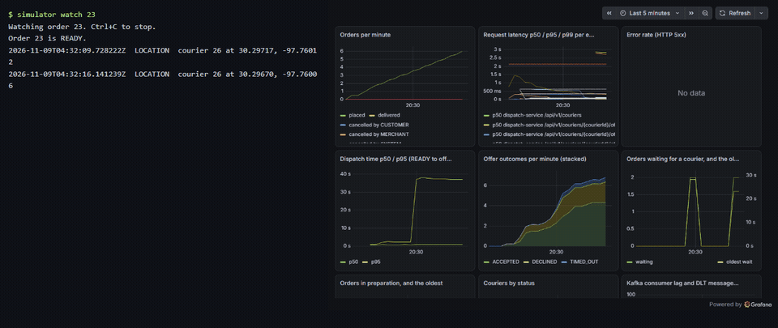
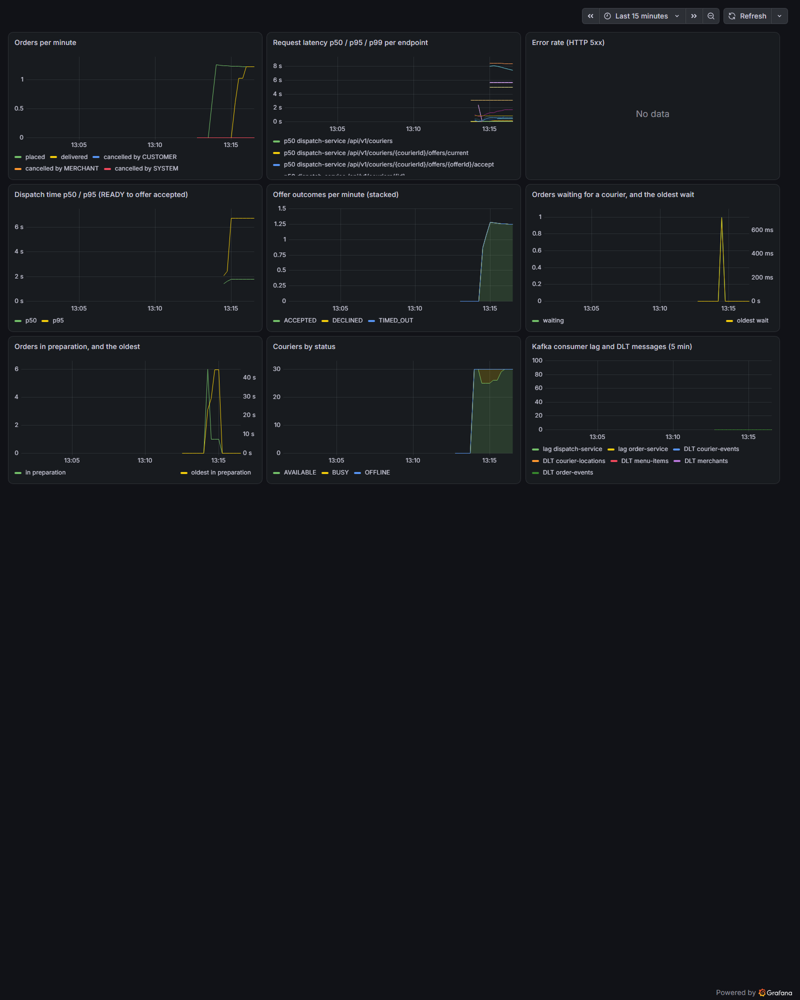
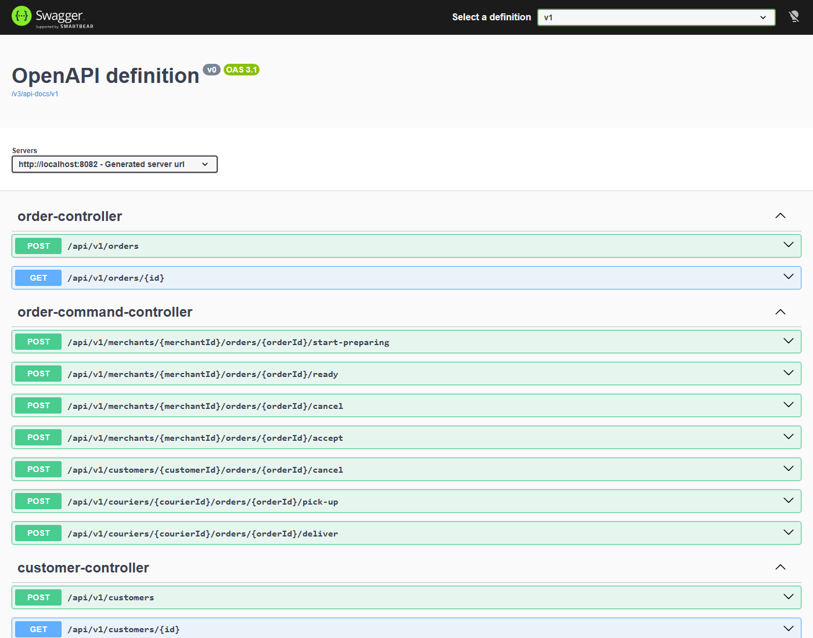
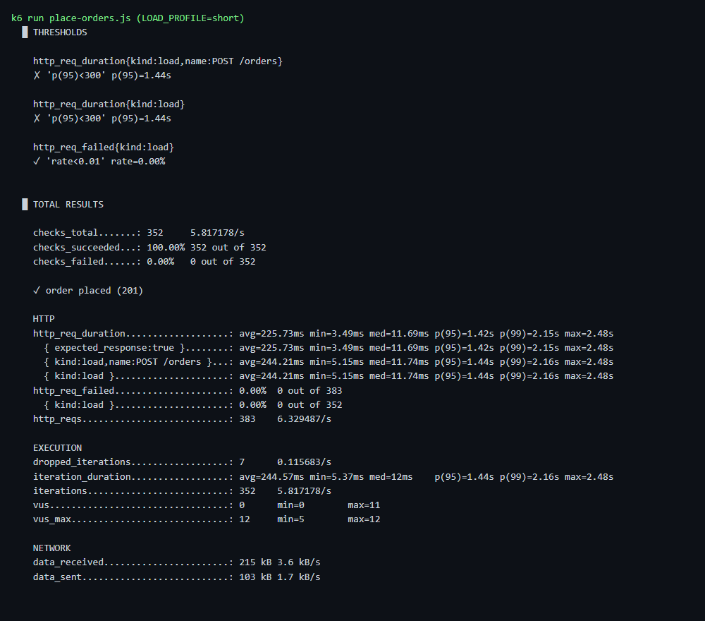
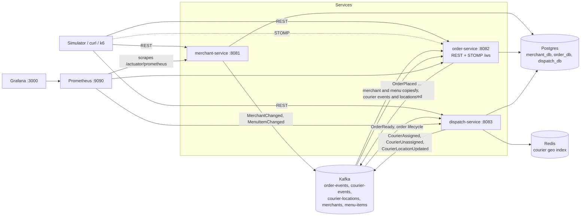

# Dropoff

A delivery-marketplace backend: customers place orders, merchants prepare them, and couriers deliver them, split into
three Spring Boot services that talk through REST and Kafka events. It runs locally with Docker Compose at no cost.

## Demo



The GIF shows `simulator watch <orderId>` printing an order's live messages next to the Grafana dashboard as orders
come in. It plays about 6x faster than real time: each frame shows for 2 s and is a headless screenshot taken about 12 s
after the one before, joined with ffmpeg. Rebuild it with `ops/media/capture.ps1` while the demo stack runs. To watch it
live, follow the [quick start](#quick-start) and [Running the simulator](#running-the-simulator).



| Swagger UI (order-service) | k6 `place-orders.js` summary |
|---|---|
|  |  |

The k6 summary was captured on a laptop with about 2 GB of free memory, so its p95 threshold fails. The clean baseline,
the median of 3 runs with every threshold passing, is in [docs/perf/README.md](docs/perf/README.md). To refresh the
screenshot, run `ops/media/capture.ps1 -K6Only` on an idle machine.

## Features

- **Merchants and menus:** create merchants and menu items, and toggle item availability.
- **Orders:** placing an order is idempotent, each line keeps a snapshot of its price, and orders move through their
  statuses with path-scoped commands (`/merchants/{id}/orders/...`).
- **Dispatch:** each ready order is offered to the nearest available courier, found with Redis geo queries. If the
  courier declines or the offer times out, the order goes to the next courier.
- **Events:** services talk through Kafka (`order-events`, `courier-events`, `courier-locations`, `merchants`,
  `menu-items`), with a transactional outbox, idempotent consumers, retries and dead-letter topics.
- **Live tracking:** STOMP over WebSocket (`ws://localhost:8082/ws`) pushes order status and courier location.
- **OpenAPI:** every endpoint is documented in Swagger UI, one per service.
- **Monitoring:** Micrometer metrics, Prometheus, and a provisioned Grafana dashboard with alert rules.
- **Load tests:** k6 scripts, plus a before-and-after write-up of the optimizations they led to.
- **Simulator:** customer, merchant and courier bots, plus a full-flow smoke test that CI runs.

## Architecture

Three services, no gateway. Each owns its own database (`merchant_db`, `order_db`, `dispatch_db`) and logs in as its own
Postgres user. Services never read each other's tables; they exchange events (ADR-0007).



- **merchant-service** owns merchants and menu items, and publishes changes to two compacted topics.
- **order-service** owns customers, orders and the order history. It validates and prices orders from local copies of
  merchants and menu items, so ordering keeps working while merchant-service is down. It also owns the WebSocket.
- **dispatch-service** owns couriers, offers and the Redis geo index. It reacts to `OrderReady`, offers the order to the
  nearest courier, and reassigns on a decline or a timeout.

## Tech stack

| Layer | Technology |
|---|---|
| Language | Java 21 |
| Framework | Spring Boot 4 (Web MVC, Data JPA, Validation, Actuator, WebSocket/STOMP), Spring Modulith |
| Build | Gradle (Kotlin DSL), Spotless, Error Prone, NullAway |
| Database | PostgreSQL 18, Flyway migrations |
| Cache and geo | Redis 8 (`GEOADD`, `GEOSEARCH`) |
| Messaging | Kafka 4 in KRaft mode (no ZooKeeper) |
| API docs | springdoc-openapi (Swagger UI) |
| Testing | JUnit 5, Mockito, Testcontainers |
| Load testing | k6 |
| Containers | Docker, Docker Compose, images on GHCR |
| CI/CD | GitHub Actions: checks, image build, Compose smoke test, integration tests, publish |
| Monitoring | Micrometer, Prometheus, Grafana |

## Quick start

You need Docker (with Compose) running. The first build also downloads a JDK 21 through the Gradle toolchain if you
have none. Give Docker about 4 GB of memory: each service container is capped at 512 MB.

```bash
git clone https://github.com/Danie1Le/Dropoff.git
cd Dropoff

# build the jars the images copy, then start infrastructure, the three services and the simulator
./gradlew :services:merchant:bootJar :services:order:bootJar :services:dispatch:bootJar :tools:simulator:installDist
docker compose --profile demo up -d --build

docker compose logs -f simulator     # seeds once, then the bots place and deliver orders
```

| What | URL |
|---|---|
| merchant-service | http://localhost:8081 |
| order-service | http://localhost:8082 (WebSocket at `ws://localhost:8082/ws`) |
| dispatch-service | http://localhost:8083 |
| Swagger UI, merchant | http://localhost:8081/swagger-ui.html |
| Swagger UI, order | http://localhost:8082/swagger-ui.html |
| Swagger UI, dispatch | http://localhost:8083/swagger-ui.html |
| Grafana (no login; `admin`/`admin` to edit) | http://localhost:3000 |
| Prometheus | http://localhost:9090 |

Compose profiles:

- no profile: only the infrastructure (Postgres, Redis, Kafka, Prometheus, Grafana), so you can run services from source
  with `./gradlew :services:<merchant|order|dispatch>:bootRun`.
- `--profile services`: infrastructure plus the three service containers.
- `--profile demo`: the same, plus the simulator.

Stop everything and drop the data and the simulator's state:

```bash
docker compose --profile demo down -v
./gradlew --stop
```

To pull the published images instead of building, see the comment at the top of `compose.yaml`.

## Running the simulator

The simulator (`tools/simulator`) has four commands: `seed`, `run`, `smoke` and `watch <orderId>`. The `demo` profile
runs `seed` once and then `run` for you. From the host, against the published ports:

```bash
./gradlew :tools:simulator:run --args="seed"                 # merchants, menus, customers and couriers
./gradlew :tools:simulator:run --args="run"                  # customer, merchant and courier bots (runs until Ctrl+C; add --duration 10m to stop)
./gradlew :tools:simulator:run --args="watch 1"              # live STATUS and LOCATION messages for order 1
docker compose --profile demo run --rm simulator smoke       # full-flow check: exits 0 if 5 orders are DELIVERED
```

Options include `--orders-per-minute`, `--speed-kmh`, `--duration`, `--orders`, `--timeout` and one URL per service.
Couriers drive at 30 km/h by default, so the first deliveries take a few minutes. Watch `delivered=` climb in the demo logs.
The host simulator keeps its ids in `.simulator/state.json`; delete that file after `docker compose down -v`.

## Order lifecycle and event flow

```
PLACED -> ACCEPTED -> PREPARING -> READY -> PICKED_UP -> DELIVERED      (or CANCELLED)
```

1. A customer calls `POST /orders` on order-service. The order is validated and priced from local merchant and menu
   copies. The same idempotency key returns the same order.
2. The merchant accepts and prepares it through path-scoped commands. Each change is written with its event in one
   transaction (the Spring Modulith event publication registry is the outbox, ADR-0006) and relayed to `order-events`.
3. On `OrderReady`, dispatch-service picks the nearest available courier from the Redis geo index and makes an offer.
   A decline or a timeout reassigns the order. It publishes `CourierAssigned` or `CourierUnassigned` to `courier-events`.
4. The courier picks up and delivers. Positions go to `courier-locations`.
5. order-service consumes those events, updates the order, and pushes `STATUS` and `LOCATION` messages to STOMP
   subscribers of `/topic/orders/{id}`.

Every consumer is idempotent (a `processed_events` table) and retries before sending a message to a `.DLT` topic. Replay
a dead letter with `ops/kafka/replay-dlt.sh order-events`.

## Design decisions

Architecture decision records live in `docs/adr/`:

- [0001 Modular monolith first, split into services later](docs/adr/0001-modular-monolith-first.md)
- [0002 Flyway owns the schema; JPA for CRUD, hand-written SQL for the rest](docs/adr/0002-flyway-owns-schema-hybrid-jpa.md)
- [0003 Foreign keys across modules until the service split](docs/adr/0003-foreign-keys-across-modules-until-split.md)
- [0004 Price snapshot on each order line](docs/adr/0004-price-snapshot-on-order-lines.md)
- [0005 Path-scoped command endpoints for order status](docs/adr/0005-path-scoped-order-commands.md)
- [0006 Spring Modulith's event publication registry is the outbox](docs/adr/0006-modulith-registry-as-outbox.md)
- [0007 Service split: a database per service and local merchant and menu copies](docs/adr/0007-service-split-local-menu-copy.md)
- [0008 Shared contracts package](docs/adr/0008-shared-contracts-package.md)

Domain terms are in [GLOSSARY.md](GLOSSARY.md), the coding rules in [CODING_STANDARDS.md](CODING_STANDARDS.md), and the
scope and milestones in [PROJECT_OVERVIEW.md](PROJECT_OVERVIEW.md) and [docs/PLAN.md](docs/PLAN.md).

## Testing

- **Unit tests** (`*Test`) need no Docker: `./gradlew test`.
- **Integration tests** (`*IT`) use Testcontainers (real Postgres, Redis and Kafka), so Docker must be running:
  `./gradlew integrationTest`, or one service with `./gradlew :services:order:integrationTest`.
- `./gradlew build` runs formatting (Spotless), static checks (Error Prone, NullAway), the unit tests and the integration
  tests. Each service also has a Spring Modulith test that verifies its module boundaries.
- `ops/smoke/full-flow.sh` places 5 orders through the real services and exits 0 once all are delivered.
  `ops/smoke/full-flow.sh --compose` runs it inside Compose, as CI does. If it reuses a state file from an earlier run
  and that file is stale (after `docker compose down -v`), it retries for 20 s before it fails.

Run one Gradle build at a time on a small machine, and `./gradlew --stop` when done.

## Performance

The k6 scripts are in `ops/k6/`. The [performance write-up](docs/perf/README.md#summary) covers the setup, the
baseline, each change with its `EXPLAIN` output, and the numbers after, with a summary table at the top.

The biggest change was a wider index and a deferred join on deep order-history pages: they now read 99 buffers per
query instead of 2,123 (-95%), and the query's mean time fell 77%. End-to-end latency was already well under the 300 ms
threshold, so the gains show up in database time rather than in the endpoint percentiles. Run a script with:

```bash
docker compose --profile demo --profile load run --rm k6 run browse.js
```

## Monitoring

Prometheus scrapes `/actuator/prometheus` on all three services every 15 s. Grafana at http://localhost:3000 opens on a
provisioned dashboard (orders per minute, latency, errors, dispatch time, offer outcomes, waiting orders, couriers by
status, consumer lag and dead letters). Its alert rules show only in the Grafana UI.


## Known gaps

- **No authentication or authorization.** Every endpoint is open, and the services trust their callers. Grafana also
  allows anonymous Viewer access on port 3000.
- **No payments.** Each order records its prices, but nothing is charged.
- **Run one order-service instance.** Its STOMP broker lives in memory, and `courier-locations` is read by a single
  consumer group, so a second instance would miss messages. Scaling out needs a consumer group per instance and a
  shared broker relay.
- **The simulator cannot resume deliveries on a second `run`.** Reset the databases (`docker compose down -v`) and delete
  `.simulator/state.json` first.
- **No map UI.** Tracking is STOMP messages that `simulator watch` prints.
- **Local only.** One Kafka broker, one Postgres, no hosted deploy.

## License

MIT, see [LICENSE](LICENSE).
