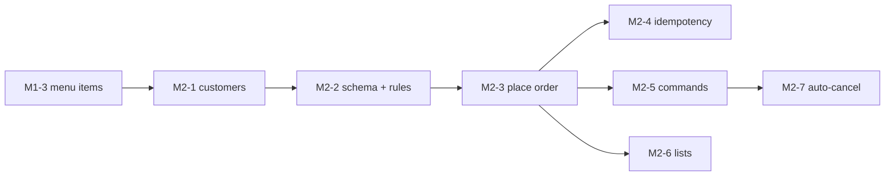

# M2 — Orders: build guide

Goal: customers place orders that move through a safe lifecycle.

`docs/PLAN.md` (section "M2 — Orders" and "Shared contracts") is the spec. This file adds the build order,
the issue for each PR, and what each PR teaches. If the two disagree, `PLAN.md` wins.

**Starts after:** M1-3 (menu items) and M1-4 (Swagger UI) are merged. Orders reference `menu_items`.

## PRs and order

| PR | Issue | Blocked by |
|---|---|---|
| M2-1 Customers | [#50](https://github.com/Danie1Le/Dropoff/issues/50) | M1-3 |
| M2-2 Order schema and status rules (TDD) | [#51](https://github.com/Danie1Le/Dropoff/issues/51) | #50 |
| M2-3 Place order | [#52](https://github.com/Danie1Le/Dropoff/issues/52) | #51 |
| M2-4 Idempotency key | [#53](https://github.com/Danie1Le/Dropoff/issues/53) | #52 |
| M2-5 Order commands and events | [#54](https://github.com/Danie1Le/Dropoff/issues/54) | #52 |
| M2-6 Order lists | [#55](https://github.com/Danie1Le/Dropoff/issues/55) | #52 |
| M2-7 Auto-cancel job | [#56](https://github.com/Danie1Le/Dropoff/issues/56) | #54 |

After M2-3, the PRs M2-4, M2-5 and M2-6 do not depend on each other. Build them in any order.

## Every PR

1. Branch `feat/m2-N-<slug>` from `main`.
2. Write the tests from the issue's "Done when" list. In M2-2, write the tests before the code.
3. Run `./gradlew build` (Spotless, Error Prone, NullAway, tests).
4. Run the `code-review` skill, and fix its findings with subagents.
5. Tick the M2 items in `docs/roadmap.html`, and bump its "Data last synced" date.
6. Open the PR with `Closes #<issue>`. The user reviews it.

## What each PR teaches

Claude writes the code. At the end of each PR, the user answers the quiz questions before merge.

### M2-1 Customers
- **SQL:** `CHECK` constraints for value ranges (`lat BETWEEN -90 AND 90`).
- **Backend:** Why a customer's address, lat and lng are changed together in one PATCH.
- **Quiz:** What happens if the API skips the range check and only the `CHECK` constraint catches a bad lat? Which HTTP status does the client get?

### M2-2 Order schema and status rules
- **SQL:** Foreign keys across modules (ADR-0003). `UNIQUE` on `idempotency_key`. `TIMESTAMPTZ` instead of `TIMESTAMP`.
- **Backend:** The state machine as pure Java with no Spring. The outbox: the event row is saved in the same transaction as the order (ADR-0006).
- **Quiz:** Why does `order_lines` copy `price_cents` instead of joining `menu_items` (ADR-0004)? Name one illegal transition, and say who may cancel an order.

### M2-3 Place order
- **SQL:** Inserting a parent row and its child rows in one transaction. A rollback undoes all of them.
- **Backend:** 404 vs 422. An id in the URL path that is not found returns 404. An id in the body that is not found returns 422.
- **Quiz:** The client sends a price. Why does the server ignore it? Which error code does an item from another merchant return?

### M2-4 Idempotency key
- **SQL:** A unique index as a lock. A second insert with the same key waits until the first transaction ends.
- **Backend:** Hashing a canonical request (sorted lines) so the same order always gets the same hash.
- **Quiz:** Two requests with the same key arrive at the same time, and the first one rolls back. What does the second one get?

### M2-5 Order commands and events
- **SQL:** The conditional update `UPDATE … WHERE status IN (…)`. "0 rows updated" means that another request changed the order first.
- **Backend:** Path-scoped commands (ADR-0005). A repeated command is a 200 no-op.
- **Quiz:** Customer and merchant cancel at the same moment. How many `order_events` rows are written? Why?

### M2-6 Order lists
- **SQL:** Hand-written `SELECT … ORDER BY … LIMIT … OFFSET`. Which index makes the merchant list fast?
- **Backend:** Offset paging and its cost on deep pages.
- **Quiz:** Write the index for "orders of merchant X with status Y, oldest first".

### M2-7 Auto-cancel job
- **SQL:** `SELECT … FOR UPDATE SKIP LOCKED`.
- **Backend:** Running a scheduled job safely on more than one app instance. Injecting a `Clock` so tests can control time.
- **Quiz:** Without `SKIP LOCKED`, what goes wrong when two instances run the job at the same moment?

## Done for M2

- All seven issues are closed, and every M2 item in `docs/roadmap.html` is ticked.
- A demo works with curl or Bruno: create a customer, place an order, then accept, prepare and ready it, or let it auto-cancel.
