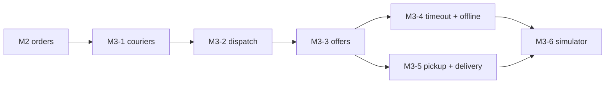

# M3 — Dispatch: build guide

Goal: ready orders get the nearest available courier, with reassignment. The dispatch module never reads `orders`;
it keeps its own `dispatch_orders`.

`docs/PLAN.md` (section "M3 — Dispatch" and "Shared contracts") is the spec. This file adds the build order,
the issue for each PR, and implementation notes for each PR. If the two disagree, `PLAN.md` wins.

**Starts after:** M2 is merged. M3-2 listens for `OrderReady` (M2-5), and M3-1 adds the FK from `orders.courier_id`
(M2-2).

## PRs and order

| PR | Issue | Blocked by |
|---|---|---|
| M3-1 Couriers and location | [#82](https://github.com/Danie1Le/Dropoff/issues/82) | #51 |
| M3-2 Dispatch on READY | [#83](https://github.com/Danie1Le/Dropoff/issues/83) | #82, #54 |
| M3-3 Offer endpoints and accepting | [#84](https://github.com/Danie1Le/Dropoff/issues/84) | #83 |
| M3-4 Timeout, offline and reassignment | [#85](https://github.com/Danie1Le/Dropoff/issues/85) | #84 |
| M3-5 Pickup and delivery | [#86](https://github.com/Danie1Le/Dropoff/issues/86) | #84 |
| M3-6 Simulator: seed and bots | [#87](https://github.com/Danie1Le/Dropoff/issues/87) | #85, #86 |



After M3-3, the PRs M3-4 and M3-5 do not depend on each other. Build them in any order.

## Every PR

1. Branch `feat/m3-N-<slug>` from `main`.
2. Write the tests from the issue's "Done when" list. In M3-2, write the candidate-selection tests before the code.
3. Run `./gradlew build` (Spotless, Error Prone, NullAway, tests). Docker must be running: the ITs start Postgres
   and Redis containers.
4. Tick the M3 items in `docs/roadmap.html`, and bump its "Data last synced" date.
5. Open the PR with `Closes #<issue>`.

## Implementation notes

### M3-1 Couriers and location
- **SQL:** A `CHECK` that ties two columns together (`status <> 'AVAILABLE' OR last_lat IS NOT NULL`). Adding a
  foreign key to an existing table with `ALTER TABLE … ADD CONSTRAINT`. `SELECT … FOR UPDATE` to lock one row.
- **Backend:** Redis geo sets (`GEOADD`, `ZREM`): a sorted set keyed by a geohash. Writing to Redis only after the
  Postgres commit, so a rollback never leaves the two stores disagreeing.

### M3-2 Dispatch on READY
- **SQL:** A partial unique index (`… WHERE status = 'OFFERED'`) as a guard against two open offers. A conditional
  `UPDATE … WHERE status = 'AVAILABLE'` as a claim.
- **Backend:** `GEOSEARCH` by radius, nearest first. Why dispatch keeps its own copy of the order (`dispatch_orders`)
  instead of reading `orders`.

### M3-3 Offer endpoints and accepting
- **SQL:** `UPDATE … AND expires_at > now()` lets the database decide whether an accept is late, with no race between
  checking and writing.
- **Backend:** One module's event (`CourierAssigned`) changes another module's table through a listener, with a guard
  (`WHERE status = 'READY'`). A shared `contracts` package for events breaks the order ↔ dispatch module cycle
  (ADR-0008).

### M3-4 Timeout, offline and reassignment
- **SQL:** A timeout job with `FOR UPDATE SKIP LOCKED`, like the auto-cancel job in M2-7.
- **Backend:** Compensating events: `CourierUnassigned` undoes an assignment in both modules.

### M3-5 Pickup and delivery
- **SQL:** Guarded listener updates (`WHERE courier_id = :courierId`) that ignore events arriving out of order.
- **Backend:** The order module owns the order status; dispatch only follows it through events.

### M3-6 Simulator: seed and bots
- **SQL:** None new. The simulator only calls the API.
- **Backend:** A load generator with a fixed random seed, so a run can be repeated exactly.

## Done for M3

- All six issues are closed, and every M3 item in `docs/roadmap.html` is ticked.
- A demo works with the simulator: `seed`, then `run`, and orders go from PLACED to DELIVERED with couriers moving.

Running the demo (Docker must be running):

```bash
docker compose up -d                                         # Postgres and Redis
./gradlew :services:order:bootRun                            # in its own terminal (was :app:bootRun before M5-6)
./gradlew :tools:simulator:run --args="seed"                 # writes .simulator/state.json
./gradlew :tools:simulator:run --args="run --speed-kmh 120 --duration 10m"   # Ctrl+C stops it early
```

`run` logs a summary every 30 s (`placed`, `ready`, offers, `pickedUp`, `delivered`). At the default 30 km/h a courier
takes 10–20 minutes per order across the 8 km city, so the demo uses `--speed-kmh 120`: the first deliveries arrive
after about 3 minutes (a checked run: 48 placed, 17 delivered, 4 offers timed out and those couriers came back, in
8 minutes). Seed against a fresh database (`docker compose down -v`): a courier bot can't resume a delivery it started
in an earlier run. Options: `--merchant-url`, `--order-url` and `--dispatch-url` (one URL per service; they replaced `--base-url` in M5-4), `--seed` (default 42), `--state`, `--orders-per-minute` (default 6),
`--speed-kmh` (default 30), `--duration`.
