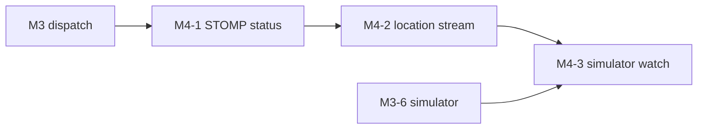

# M4 — Live tracking: build guide

Goal: customers watch their order and courier move live. The order module owns the WebSocket: it pushes every
status change, and later every courier location, to `/topic/orders/{id}`.

`docs/PLAN.md` (section "M4 — Live tracking" and "Shared contracts") is the spec. This file adds the build order,
the issue for each PR, and what each PR teaches. If the two disagree, `PLAN.md` wins.

**Starts after:** M3 is merged. M4-1 pushes the pick-up and delivery statuses from M3-5, M4-2 reads the
`dispatch_orders` states from M3-3 to M3-5, and M4-3 adds a command to the M3-6 simulator.

## PRs and order

| PR | Issue | Blocked by |
|---|---|---|
| M4-1 STOMP status updates | [#94](https://github.com/Danie1Le/Dropoff/issues/94) | #86 |
| M4-2 Courier location stream | [#95](https://github.com/Danie1Le/Dropoff/issues/95) | #94, #86 |
| M4-3 Simulator watch | [#96](https://github.com/Danie1Le/Dropoff/issues/96) | #95, #87 |

The three PRs form a chain: each one builds on the messages of the one before.

## Every PR

1. Branch `feat/m4-N-<slug>` from `main`.
2. Write the tests from the issue's "Done when" list. In M4-2, write the throttle test (0 s, 2 s, 6 s) before the
   code, with a clock the test moves by hand instead of real sleeps.
3. Run `./gradlew build` (Spotless, Error Prone, NullAway, tests). Docker must be running: the ITs start Postgres
   and Redis containers.
4. Run the `code-review` skill, and fix its findings with subagents.
5. Tick the M4 items in `docs/roadmap.html`, and bump its "Data last synced" date.
6. Open the PR with `Closes #<issue>`. The user reviews it.

## What each PR teaches

Claude writes the code. At the end of each PR, the user answers the quiz questions before merge.

### M4-1 STOMP status updates
- **SQL:** None new. The message is built from the same values as the `order_events` row, so the audit trail and
  the push always agree.
- **Backend:** STOMP frames (`CONNECT`, `SUBSCRIBE`, `MESSAGE`) over a raw WebSocket, and Spring's in-memory simple
  broker fanning a message out to every subscriber of a topic. Sending only after commit with a
  `TransactionSynchronization`, the same trick as the Redis writes in M3-1. Blocking client `SEND` frames, so a
  client cannot fake a status on someone else's topic.
- **Quiz:** Why is the `STATUS` message sent after the commit and not when the `UPDATE` runs? A customer subscribes
  to `/topic/orders/7` after the merchant accepted. Which messages do they get, and how do they learn the current
  status? Why may a client subscribe but never `SEND`?

### M4-2 Courier location stream
- **SQL:** Every location update is still a Postgres write; only the push is throttled.
- **Backend:** A Redis key with `SET … NX EX 5` as a cheap rate limiter that works across instances. A plain
  `@EventListener` for a high-volume event that is fine to lose, compared with the event registry used for the
  events that must not be lost.
- **Quiz:** A courier sends locations at 0 s, 2 s and 6 s. How many `LOCATION` messages go out, and why? Why does
  `CourierLocationUpdated` skip the event registry when `OrderReady` uses it?

### M4-3 Simulator watch
- **SQL:** None new. The simulator only calls the API.
- **Backend:** Writing STOMP frames by hand: a text command line, headers, a blank line, the body and a NUL byte.
- **Quiz:** What does the client send to start receiving an order's messages, and what ends each frame?

## Done for M4

- All three issues are closed, and every M4 item in `docs/roadmap.html` is ticked.
- A demo works with the simulator: `seed`, `run`, then `watch <orderId>` prints the statuses and the courier moving.
