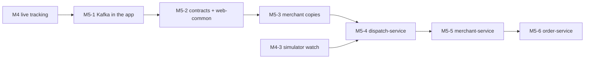

# M5 — Kafka & service split: build guide

Goal: three services talking through durable events. Each PR leaves a working system: first Kafka carries the events
inside the one app, then the shared code moves into Gradle modules, then the order module stops reading merchant
tables, and only then do dispatch, merchant and order become separate services.

`docs/PLAN.md` (section "M5 — Kafka & service split" and "Shared contracts") is the spec. This file adds the build
order, the issue for each PR, and what each PR teaches. If the two disagree, `PLAN.md` wins.

**Starts after:** M4 is merged. M5-1 moves the M3 and M4 listeners (`OrderReady`, `CourierAssigned`,
`CourierLocationUpdated` …) onto Kafka, and M5-4 extends the simulator from M3-6 and M4-3.

## PRs and order

| PR | Issue | Blocked by |
|---|---|---|
| M5-1 Kafka inside the app | [#100](https://github.com/Danie1Le/Dropoff/issues/100) | #95 |
| M5-2 Contracts and web-common | [#101](https://github.com/Danie1Le/Dropoff/issues/101) | #100 |
| M5-3 Order module uses merchant copies | [#102](https://github.com/Danie1Le/Dropoff/issues/102) | #101 |
| M5-4 Extract dispatch-service | [#103](https://github.com/Danie1Le/Dropoff/issues/103) | #102, #96 |
| M5-5 Extract merchant-service | [#104](https://github.com/Danie1Le/Dropoff/issues/104) | #103 |
| M5-6 Remaining app becomes order-service | [#105](https://github.com/Danie1Le/Dropoff/issues/105) | #104 |



The six PRs form a chain (ticket #42, point 3). Each extraction needs the step before it: dispatch can leave only
once its events go through Kafka, and merchant can leave only once ordering no longer reads its tables.

## Every PR

1. Branch `feat/m5-N-<slug>` from `main`.
2. Write the tests from the issue's "Done when" list. In M5-1, write the three Kafka ITs (after commit and not after
   rollback, duplicate, poison message) before the wiring.
3. Run `./gradlew build` (Spotless, Error Prone, NullAway, tests). Docker must be running: the ITs start Postgres,
   Redis and one Kafka broker shared by every test context. Don't sleep in a test to wait for a consumer: wait on
   the state it changes, or on `KafkaTestSupport.awaitSettled`.
4. Run the `code-review` skill, and fix its findings with subagents.
5. Tick the M5 items in `docs/roadmap.html`, and bump its "Data last synced" date.
6. Open the PR with `Closes #<issue>`. The user reviews it.

## What each PR teaches

Claude writes the code. At the end of each PR, the user answers the quiz questions before merge.

### M5-1 Kafka inside the app
- **SQL:** `INSERT … ON CONFLICT DO NOTHING` as a dedupe check: the row count (1 or 0) says whether this consumer
  group has seen the event before. The `processed_events` row commits in the same transaction as the handler's work,
  so a rolled-back handler leaves no trace and its redelivery runs again.
- **Backend:** The transactional outbox: the Modulith registry stores each event in the transaction that publishes
  it and relays it to Kafka after the commit, so a rolled-back change never sends an event. At-least-once delivery
  and why consumers must dedupe. Topics, keys and partitions: every order event is keyed by orderId, so one order's
  events stay in order. Consumer groups: two listeners in one group split a topic's partitions. Retries with backoff,
  then a dead-letter topic, and replaying it with `ops/kafka/replay-dlt.sh`.
- **Quiz:** The order commits, then the app crashes before the event reaches Kafka. What sends it, and when? Kafka
  delivers `CourierAssigned` twice. What stops the second one from being applied? Why is every order event keyed by
  orderId, and what could go wrong with a random key? A record is not valid JSON. Does it get 3 retries? Where does it
  end up?

### M5-2 Contracts and web-common
- **SQL:** None new.
- **Backend:** Gradle modules with their own dependencies: a `contracts` module with no Spring on its classpath, so
  nothing Spring-specific can creep into the shared events. `libs/web-common` for the error handling every service
  needs.
- **Quiz:** Why must `contracts` have no Spring on its classpath, and what would break at the split if it did? Why are
  changes to an event record additive only?

### M5-3 Order module uses merchant copies
- **SQL:** Upserts (`INSERT … ON CONFLICT (id) DO UPDATE`) to keep a local copy current. A compacted topic keeps only
  the latest record per key, so replaying it from offset 0 rebuilds the whole table.
- **Backend:** Owning your data: the order module validates and prices orders from its own copies, so ordering still
  works while merchant-service is down (ADR-0007).
- **Quiz:** `merchant_copies` is empty at startup. How does the order module fill it? A merchant closes. How long
  until ordering from them is rejected, and with which code?

### M5-4 Extract dispatch-service
- **SQL:** A database per service, and dropping foreign keys that would cross databases (ADR-0003).
- **Backend:** Moving a module into its own Spring Boot app, with its own Flyway history, `event_publication` and
  `processed_events`. A smoke test that runs the whole flow across services.
- **Quiz:** Why do the FKs between dispatch and order tables have to go? What now stops a `dispatch_orders` row from
  pointing at an order that does not exist?

### M5-5 Extract merchant-service
- **SQL:** Dropping the last FKs from `order_lines` and `orders` to merchant tables.
- **Backend:** Graceful degradation: ordering only reads local copies, so it keeps working with merchant-service
  stopped.
- **Quiz:** Merchant-service is stopped and a customer places an order. What happens, and why? What changes once it
  comes back?

### M5-6 Remaining app becomes order-service
- **SQL:** None new; fresh databases are seeded by the simulator.
- **Backend:** Each service keeps its own Modulith verify test, so module boundaries inside a service stay checked.
- **Quiz:** Which service owns the WebSocket, and why there and not in dispatch, which knows the courier's location?

## Done for M5

- All six issues are closed, and every M5 item in `docs/roadmap.html` is ticked.
- `ops/smoke/full-flow.sh` passes against the three services: 5 orders placed and all DELIVERED within 5 minutes.

Running the app with Kafka (from M5-1; Docker must be running):

```bash
docker compose up -d                                         # Postgres, Redis and Kafka
./gradlew :app:bootRun                                       # creates the topics on startup
ops/kafka/replay-dlt.sh order-events                         # sends order-events.DLT back to order-events
```
