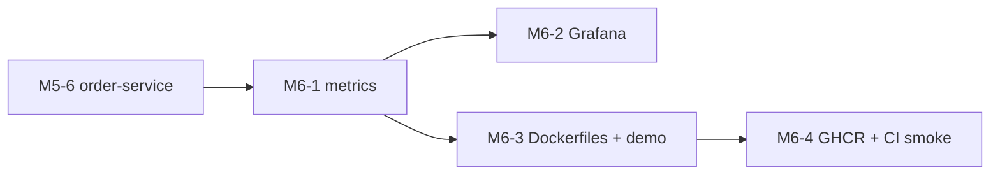

# M6 — Ops: build guide

Goal: containers, published images and dashboards. First every service exposes its metrics and Prometheus scrapes
them, then Grafana turns them into a dashboard and alerts, then each service gets an image, and finally CI publishes
the images and runs the full-flow smoke test against them.

`docs/PLAN.md` (section "M6 — Ops") is the spec. This file adds the build order, the issue for each PR, and
implementation notes for each PR. If the two disagree, `PLAN.md` wins.

**Starts after:** M5 is merged. M6-1 adds metrics to the three services M5 split out (merchant 8081, order 8082,
dispatch 8083), and M6-3 packages them.

## PRs and order

| PR | Issue | Blocked by |
|---|---|---|
| M6-1 Metrics | [#112](https://github.com/Danie1Le/Dropoff/issues/112) | #105 |
| M6-2 Grafana as code | [#113](https://github.com/Danie1Le/Dropoff/issues/113) | #112 |
| M6-3 Dockerfiles and the demo profile | [#114](https://github.com/Danie1Le/Dropoff/issues/114) | #112 |
| M6-4 Publish to GHCR and the CI smoke test | [#115](https://github.com/Danie1Le/Dropoff/issues/115) | #114 |



The dashboard needs the metrics it charts, so M6-2 follows M6-1. M6-3 also follows M6-1: both edit `compose.yaml`, and
once the services run as containers Prometheus scrapes them by name instead of through `host.docker.internal`. M6-4
publishes the images M6-3 builds and runs the smoke test against them. M6-2 and M6-3 can go in either order.

## Every PR

1. Branch `feat/m6-N-<slug>` from `main`.
2. Write the tests from the issue's "Done when" list first. M6-2 and M6-4 are checked by running them (Grafana in
   Compose, the workflow on `main`), so their PRs carry a screenshot or a link to the run.
3. Run `./gradlew build` (Spotless, Error Prone, NullAway, tests). Docker must be running for the ITs.
4. Tick the M6 items in `docs/roadmap.html`, and bump its "Data last synced" date.
5. Open the PR with `Closes #<issue>`.

## Implementation notes

### M6-1 Metrics
- **SQL:** Aggregates for gauges: one row with `count(*)` and `min(ready_at)` turned into an age with
  `extract(epoch FROM now() - …)`, and `count(*) FILTER (WHERE status = …)` to count every courier status in one scan.
  `coalesce` makes an empty table read as 0, not NULL. A partial index (`WHERE status IN ('ACCEPTED', 'PREPARING')`)
  keeps a query that runs every 15 s from scanning every order ever placed. `UPDATE … RETURNING ready_at` reads the
  value the accept needs for the dispatch timer in the same statement that changes the row.
- **Backend:** Pull-based metrics: Prometheus scrapes `/actuator/prometheus`, and Micrometer names map to Prometheus
  names (`dropoff.orders.placed` becomes `dropoff_orders_placed_total`). Counters only go up, gauges are read at scrape
  time, and timers with histogram buckets let Prometheus compute percentiles across instances. Tags stay low
  cardinality (status, actor, outcome, topic; never an id). Counters move after commit, so a rolled-back change is
  never counted. Gauges come from one cached query, so many scrapes cost one query per 15 s. Micrometer holds a gauge's
  state weakly, so the state must be kept alive (`strongReference(true)`).

### M6-2 Grafana as code
- **SQL:** None.
- **Backend:** PromQL: `rate()` and `increase()` over counters, `histogram_quantile()` over buckets. Grafana
  provisioning from files (datasource, dashboard JSON, alert rules), so a fresh `docker compose up` shows the same
  dashboard. Alerts that only show in the UI, since email or SMS would cost money.

### M6-3 Dockerfiles and the demo profile
- **SQL:** None.
- **Backend:** Layered jars: dependencies change rarely, so they sit in a lower image layer than the app's classes, and
  a code change rebuilds only the top layer. A JRE base image instead of a JDK, and a non-root user. Compose profiles:
  `services` adds the three service containers and `demo` adds the simulator too, only when asked for.

### M6-4 Publish to GHCR and the CI smoke test
- **SQL:** None.
- **Backend:** Publishing only after tests pass, image tags (`sha-<short>` for a precise build, `main` and `latest` as
  moving pointers), `GITHUB_TOKEN` with `packages: write` instead of a stored secret, and an end-to-end smoke test
  against the images that were just built.

## Done for M6

- All four issues are closed, and every M6 item in `docs/roadmap.html` is ticked.
- `docker compose --profile demo up` runs the services from their images with the simulator, Grafana shows the
  dashboard, and the `main` workflow pushes the images and passes the smoke test.
- The four GHCR packages are set to Public (one-time, after the first `main` run), and
  `DROPOFF_TAG=main docker compose --profile demo pull merchant order dispatch simulator` works logged out.

Running everything in containers (from M6-3; Docker must be running):

```bash
./gradlew :services:merchant:bootJar :services:order:bootJar :services:dispatch:bootJar :tools:simulator:installDist
docker compose --profile demo up -d --build                  # infra, the three services and the simulator
docker compose logs -f simulator                             # seeds once, then the bots place and deliver orders
docker compose --profile demo run --rm simulator smoke       # the full-flow check, exit 0 if 5 orders deliver
curl -s localhost:8083/actuator/prometheus | grep '^dropoff_'   # one service's own metrics
docker compose --profile demo down -v                        # stop, and drop the data and the simulator's state
```

Profiles: a plain `docker compose up -d` starts only the infrastructure (Postgres, Redis, Kafka, Prometheus, Grafana),
as before M6-3, so the M3 and M5 `bootRun` steps still work. `--profile services` adds the three service containers,
and `--profile demo` adds the simulator as well. To run one service from source next to the other two containers, name
those two (`docker compose up -d merchant order`; a named service starts whatever its profile) and `bootRun` the third.
Prometheus scrapes only the containers. The Dockerfile copies the jar Gradle built, so rebuild it before `--build`.

State files: the demo simulator keeps its seeded ids in `/data/state.json` on the `simulator-data` volume, and the
smoke command in `/data/smoke-state.json` on the same volume, so smoke seeds and drives its own merchants and couriers
while the demo bots run. `ops/smoke/full-flow.sh` runs the simulator on the host, which keeps `.simulator/state.json`
in the repo. `docker compose --profile demo down -v` drops both container files; delete the host file yourself. Smoke
checks a reused state file against the services before the first order and retries a 404 or connection error for 20 s,
so a stale file fails after that delay; a file smoke just seeded is not checked.

The images stay under 300 MB (`ops/docker/check-image-sizes.sh`, run in CI). On the full
`eclipse-temurin:21-jre-alpine` the service images measured 305-315 MB, so `ops/docker/service.Dockerfile` links a
smaller Temurin 21 runtime with `jlink` and runs it on plain `alpine`, giving 178-188 MB (#36, amended). The simulator
keeps `eclipse-temurin:21-jre-alpine` (215 MB in all). Each service is capped at 512 MB (`-Xmx256m`), the simulator at
256 MB; the compose.yaml header says what to raise if a container is OOM-killed.

CI (M6-4) builds the four images once per run, size-checks them, and runs `ops/smoke/full-flow.sh --compose`: Compose
boots the three services, waits for their healthchecks, and the simulator image places 5 orders that must all be
DELIVERED within 5 minutes, or the build fails. On a push to `main` or a `v*` tag, after the integration tests pass,
the build job hands the same images to the `publish` job (a one-day artifact), which pushes them to GHCR with the run's
`GITHUB_TOKEN` (`packages: write`, that job only). Pull requests never publish. The same job then prunes each package,
keeping the newest 5 `sha-*` versions and never deleting `main`, `latest` or release tags.

One manual step, once: GHCR creates a package as private the first time, and `GITHUB_TOKEN` cannot change that. After
the first run on `main`, open each of the four packages (`dropoff-merchant`, `dropoff-order`, `dropoff-dispatch`,
`dropoff-simulator`) under https://github.com/Danie1Le?tab=packages, then Package settings, Danger Zone, Change
visibility, Public. Also check that "Manage Actions access" lists this repo with Write. Public packages are free and
have no storage limit; a private one is capped at 500 MB on the free plan.

| Trigger | Tags pushed for `ghcr.io/danie1le/dropoff-{merchant,order,dispatch,simulator}` |
|---|---|
| push to `main` | `sha-<short sha>` (one exact build: deploy or roll back to this) and `main` (moving) |
| tag `v1.2.3` | `1.2.3` and `latest` (moving) |

To run the published images instead of building them, pick a tag (no jars or `--build` needed). This works only once
the packages are public (see above); before that, the pull fails with `denied` or `unauthorized`:

```bash
DROPOFF_TAG=main docker compose --profile demo pull merchant order dispatch simulator
DROPOFF_TAG=main docker compose --profile demo up -d
```

Prometheus scrapes the services by Compose service name (`merchant:8081`, `order:8082`, `dispatch:8083`), each with a
`service` label. Its UI at http://localhost:9090 lists the three
targets under Status, Targets. Each service measures its own part of the flow:

| Service | Metrics |
|---|---|
| order | `dropoff_orders_placed_total`, `dropoff_orders_cancelled_total{actor}`, `dropoff_orders_delivered_total`, `dropoff_orders_in_preparation`, `dropoff_oldest_in_preparation_age_seconds` |
| dispatch | `dropoff_offers_total{outcome}`, `dropoff_dispatch_duration_seconds`, `dropoff_orders_waiting_for_courier`, `dropoff_oldest_waiting_order_age_seconds`, `dropoff_couriers{status}` |
| every service | `dropoff_dlt_messages_total{topic}`, `http_server_requests_seconds` (with buckets), JVM, HikariCP and Kafka client metrics |

The in-preparation age counts from the ACCEPTED event, so it shows how long the kitchen has had the order (decision
#13 takes no automatic action there). The waiting age counts from `ready_at`, the age the M6-2 alert watches. Gauges
reload at most every `dropoff.metrics.gauge-max-age` (15 s); tests set it to 0 so they see their own rows.
