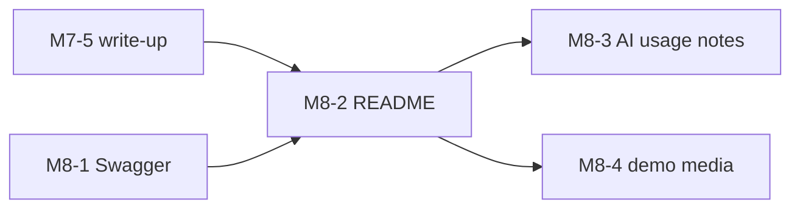

# M8 — Polish: build guide

Goal: a repo a reviewer can understand at a glance. First the API docs (Swagger) are complete, then the README that
points at them, then the AI usage notes, and last the demo media that the README embeds.

`docs/PLAN.md` (section "M8 — Polish") is the spec, and ticket #37 holds the README and docs decisions. This file adds
the build order, the issue for each PR, and what each PR teaches. If the two disagree, `PLAN.md` wins.

**Starts after:** M7 is merged, or at least M7-5 (the performance write-up), because the README links to
`docs/perf/README.md`. M8-1 itself only needs the three services from M5.

## PRs and order

| PR | Issue | Blocked by |
|---|---|---|
| M8-1 Swagger completeness | [#128](https://github.com/Danie1Le/Dropoff/issues/128) | none |
| M8-2 README | [#129](https://github.com/Danie1Le/Dropoff/issues/129) | #128, #123 |
| M8-3 AI usage notes | [#130](https://github.com/Danie1Le/Dropoff/issues/130) | #129 |
| M8-4 Demo media | [#131](https://github.com/Danie1Le/Dropoff/issues/131) | #129 |



The README links to the Swagger UIs and to the performance table, so both come first. The README is written before
the AI notes and the media so it can name them; each of those two PRs then adds its own link or image to the README.
M8-3 and M8-4 do not depend on each other.

## Every PR

1. Branch `feat/m8-N-<slug>` from `main`.
2. Write the tests from the issue's "Done when" list first. M8-2, M8-3 and M8-4 have no tests (docs PRs); M8-1 extends
   each service's `OpenApiDocsIT`.
3. Run `./gradlew build` (Spotless, Error Prone, NullAway, tests). Docker must be running for the ITs.
4. Run the `code-review` skill, and fix its findings with subagents.
5. Tick the M8 items in `docs/roadmap.html`, and bump its "Data last synced" date.
6. Open the PR with `Closes #<issue>`. The user reviews it.

## What each PR teaches

Claude writes the code. At the end of each PR, the user answers the quiz questions before merge.

### M8-1 Swagger completeness
- **SQL:** None.
- **Backend:** The OpenAPI document is generated from the code, so docs stay true only if a test reads them. Where
  each piece comes from: `@Operation` gives the summary; `@Schema(example = ...)` on a record component gives a field
  its example, and Swagger UI builds the request sample from those; `@ProblemResponse` lists the error codes; a global
  customizer (`PathParameterDocs`) describes path parameters once instead of on 40 methods. The IT walks the finished
  `/v3/api-docs/v1` and fails when an operation has no summary, a path parameter no description or example, a body no
  schema, or a scalar field no example. A new endpoint then cannot ship half-documented.
- **Quiz:** Why does a test on `/v3/api-docs` catch more than a code review of the annotations? Why is the path
  parameter text a global customizer and not an annotation per endpoint, and what does it give up? Why do the enum
  fields (`status`) not need an `example`?

### M8-2 README
- **SQL:** None.
- **Backend:** Writing for a reader with five minutes: what it is, a diagram, how to run it, where to look next. A
  quick start only counts if someone ran it from a clean clone. Known gaps (no auth, no payments) stated up front
  read as scope decisions, not omissions.
- **Quiz:** Which parts of the quick start would break on a clean machine, and how did you find out? Why list the
  known gaps instead of leaving them out?

### M8-3 AI usage notes
- **SQL:** None.
- **Backend:** Honest provenance: which tools wrote what, how each change was checked (tests, `code-review` on every
  PR, your review, the quizzes), and the mistakes that checking caught.
- **Quiz:** Which of those checks would have caught a wrong-but-plausible query? Which mistake did only your own
  review find?

### M8-4 Demo media
- **SQL:** None.
- **Backend:** Evidence beats description: a GIF under 30 s and 10 MB of `watch` plus Grafana, and screenshots of
  Swagger, Grafana and the k6 summary. Media is committed binary, so size limits matter for clone time.
- **Quiz:** Why cap the GIF at 10 MB? What in the Grafana screenshot shows the system working, not just running?

## Done for M8

- All four issues are closed, and every M8 item in `docs/roadmap.html` is ticked.
- The README has the 15 sections, the diagram, the quick start, the known gaps, and links to `docs/ai-usage.md`,
  `docs/perf/README.md` and the media.
- Each service's Swagger UI shows every endpoint with a summary, examples and its error codes.

Looking at the docs (Docker must be running for the services):

```bash
docker compose --profile demo up -d --build
# Swagger UI: http://localhost:8081/swagger-ui.html (merchant), 8082 (order), 8083 (dispatch)
# OpenAPI JSON: http://localhost:8082/v3/api-docs/v1
```
